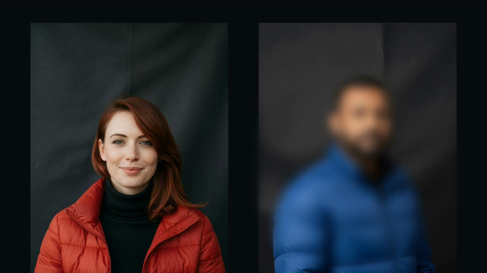
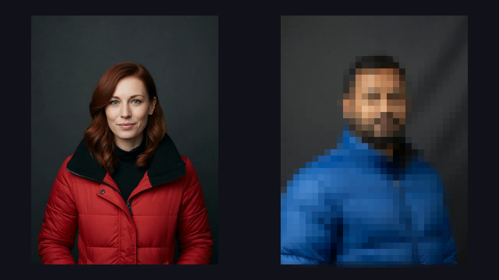

# ReelForge Host

One shared MCP for prompt-driven movie production and existing-media processing.

## Create an animated movie from a prompt

Run the persistent Host (`reelforge-host serve --http`) and open the
[Studio web app](https://github.com/sergii-ziborov/ReelForge-Studio).
The movie tools use authenticated Codex CLI for planning and native ImageGen
for missing visual assets. Host owns the budget, accepted bytes, animation,
rendering and output checks. No OpenAI API key or image API fallback is used.

```json
{"jsonrpc":"2.0","id":1,"method":"tools/call","params":{"name":"movie_create","arguments":{"id":"space-chase","prompt":"A cyan comet collects three sparks while a violet echo follows its earlier path. A portal opens and the comet escapes. Finish with a short title.","duration":10,"width":1280,"height":720,"fps":24,"max_images":10}}}
```

The call returns immediately. `movie_inspect` reports progress, current revision,
the saved Weavatrix Graph, changed/affected nodes and exact asset receipts.
Weavatrix Memory supplies the checksummed, versioned event store. Native
ReelForge `SceneDocument`, scene compiler and streaming encoder supply the
motion and final H.264/AAC file. Studio and its mcport shim forward this same
Host catalog.

| Tool | Behavior |
| --- | --- |
| `movie_create` | Prompt, duration, canvas, fps and per-video image cap; optional named absolute reference paths |
| `movie_inspect` | Status, saved scene intent, dependencies, receipts, input changes and qualified output URL |
| `movie_revise` | New prompt plus `base_revision`; verify/reuse unchanged assets and rebuild affected output |
| `movie_rebuild` | Current `base_revision`; rebuild the saved scene without another planning call |
| `movie_cancel` | Stop CLI work or cooperatively cancel native export |
| `movie_resume` | Reopen saved work; recover completed generation before considering another request |

`GET /movies/<id>/video` serves only a completed, checked output with current
inputs and matching bytes. It supports HEAD and explicit byte ranges, and uses
the same bearer-token policy as `/mcp`.

Configure `REELFORGE_MOVIES` for persistent projects (default `work/movies`),
`REELFORGE_CODEX` for the native Codex executable when it is absent from PATH,
and optionally `REELFORGE_FONT` for native captions. Install FFmpeg/ffprobe and
authenticate Codex CLI before starting the Host. Windows launches the native
executable directly without an intermediate shell. Planning runs read-only;
image roles have separate job workspaces.

Image reservations are committed before launch and remain consumed after an
unknown outcome. Resume recovers a completed native result without making a
duplicate request. If an outcome cannot be qualified, production stops with its
reservation retained. The supported receipt profile correlates Codex exec JSON
with its local session trace and exactly one native PNG in that thread's output
directory; it was exercised with Codex CLI 0.154.0 on Windows. An agent saying
"imagegen" is insufficient evidence. A changed CLI trace contract is rejected.
`images_already_used` includes earlier attempts in the same video's total cap.

The current profile renders 1–30 second scenes aligned with the requested frame
clock, using layered 2D scenes with separate moving
objects, exact delayed followers, computed trails, collection/portal/exit events,
native captions and synthesized music/cues. At least two visible moving objects
are required. The output check decodes video/audio and verifies timing, canvas,
frame variation, event contact and audio levels. Visual storytelling quality
still requires review; frame variation alone is not proof of good animation.
Speech synthesis, character articulation and long-form shot production are
outside this implemented profile.

```text
  video / photo
        │
        ▼
 ┌──────────────┐
 │ ReelForge-Host│   reelforge-host  (this repo)
 │  MCP + CLI   │
 └──────┬───────┘
        │
        ├── SightLoom (+ sightloom-host)   detect / enroll / search / VisionIndex
        ├── Intelligence                   rewrite_selectors → resolve → graph
        ├── ReelForge                      run_render_graph / encode
        └── Capture                        session / CaptureProject → committed media URIs
```

Host does **not** invent VisionIndex, SemanticEditPlan, or RenderGraph. It calls the siblings.

## Killer path

```bash
reelforge-host privacy-except \
  --video scene.mp4 \
  --photo keep.jpg \
  --output out.mp4 \
  --work-dir ./work \
  --sample-fps 2 \
  --max-frames 30 \
  --style pixelate          # default; gaussian is recoverable, not anonymity
```

`--style` / MCP `style`: `pixelate` (default) | `gaussian` | `solid`. Intelligence itself still defaults to gaussian so existing compiler callers do not change appearance.

### Proof

Same Host job: one reference still of the person to keep → Accept → everyone else is redacted. These are **synthetic** portraits generated for the demo (not photographs of real people).

Reference photo:


| Before | After (`privacy-except`) |
| --- | --- |
|  |  |

Pixelate (Host default, anonymity):



Cartoon stand-in of the same contract (keep one, redact the rest):


Video demos stay off this repo until a job is approved. The contract that ships is CLI + MCP + LSP.

```bash
# detect+reid FPS only (no photo / encode)
reelforge-host ingest --video scene.mp4 --sample-fps 2 --max-frames 6 --embed-every 2

# live camera (Windows dshow) or synthetic
reelforge-host ingest --video cam --live-secs 3
reelforge-host ingest --video "lavfi:testsrc=size=640x360:rate=10" --live-secs 2

# Capture session or project (committed segments only — never glob the tail)
reelforge-host ingest --video ./sessions/ses_abc
reelforge-host ingest --video project.json
reelforge-host privacy-except --video capture:ses_abc --photo keep.jpg --output out.mp4
```

Capture **grabs**. Host **ingests** `media[].uri` / committed session segments. Unfinished `segments/` files are ignored.

1. ffmpeg frames (RGB + pts)
2. `HostPipeline.ingest_frame`
3. `enroll_photo` / `search_photo` → subject id
4. `session.save_package(work/vision_index)`
5. Intelligence `rewrite_selectors` (FramePick → SubjectIds)
6. `resolve-bridge --mode final --write-mask-package`
7. `run_render_graph` + `SightloomPackageHost`

If photo search is not **Accept**, the process stops. It does not guess a subject.

Source **audio is muxed** into the output (ReelForge companion track). Silent files and live grab (`-an`) stay silent. If the source has audio and encode drops it, the process fails.

Missing ONNX weights → **exit 2** (CI-friendly). Host does not vendor models. It looks in:

1. `--models-dir` / MCP `models_dir`
2. `REELFORGE_MODELS` / `SIGHTLOOM_MODELS`
3. `./.sightloom-models`
4. sibling `../SightLoom/.sightloom-models` (`yolov8n.onnx` + `person_reid.onnx`)

SightLoom owns the ONNX loaders; this process only picks the cache and runs the pipeline.

## MCP

```bash
reelforge-host privacy-except --video scene.mp4 --photo keep.jpg --output out.mp4
reelforge-host serve                          # stdio JSON-RPC
reelforge-host serve --http                   # http://127.0.0.1:8787/mcp
reelforge-host serve --http 127.0.0.1:0       # ephemeral port (printed on stderr)
reelforge-host serve --http 0.0.0.0:8787 --token "$REELFORGE_HOST_TOKEN"
reelforge-host lsp                            # stdio LSP for job JSON / SemanticEditPlan
reelforge-host methods
```

HTTP is the same JSON-RPC as stdio (`POST /mcp` or `POST /`). `GET /health` is a liveness probe. Non-loopback binds refuse to start without `--token` / `REELFORGE_HOST_TOKEN` (`Authorization: Bearer …` or `X-ReelForge-Token`). CORS is open so local Studio (Vite / egui) can call loopback Host.

| Tool | Role |
| --- | --- |
| `ingest_video` | decode + detect/track/embed + save package |
| `enroll_photo` | JPEG/PNG → gallery subject |
| `search_photo` | JPEG/PNG → ranked hits |
| `rewrite_plan` | FramePick → SubjectIds |
| `resolve_bridge` | Intelligence freeze + graph JSON |
| `compile_scene` | Editable SceneDocument + media bindings + canvas → posed RenderGraph |
| `run_graph` | ReelForge encode |
| `privacy_except` | all of the above |

Intelligence compiler tools (`compile_plan`, …) are **not** proxied.

`compile_scene` takes `scene` (the existing versioned `SceneDocument`), `media`
(`[{"id":"picture","uri":"/path/to/accepted.png"}]`), and `canvas`
(`{"width":1280,"height":720,"duration":{"ticks":72,"timescale":24}}`).
It returns the posed `graph`, scene id, duration, and visible-part count. It does
not open media or encode. Set a graph output URI, save the graph, then call
`run_graph`. Unsupported source masks and invalid scene links are refused by
the same compiler used by the native project API.

The [`scene_movie` example](examples/scene_movie.rs) renders a saved set of scene
requests as one movie through these same Host methods. Its JSON has `shots`
(each a `compile_scene` request), `fps`, and `output`; optional `titles` contain
`text`, `size`, `font`, and PNG `uri` for native text rasterization, and optional
`audio` cues contain accepted file `uri`, `gain`, and `start` in seconds.
`audio_gain` sets the final mix gain. It namespaces each scene graph, concatenates
shots, mixes cues, saves the executable graph and scene previews, and exports.
This low-level example expects accepted image/audio files. Automatic prompt
production uses the persistent `movie_*` tools above.

```sh
cargo run --release --example scene_movie -- /path/to/movie.json
```

**Agents** should call this process (`serve` / `serve --http`), not Intelligence and not a separate “ReelForge-MCP” repo. Editors use `reelforge-host lsp` for the same JSON. Surfaces (egui / Vite / mcport shim) live in [ReelForge-Studio](https://github.com/sergii-ziborov/ReelForge-Studio) and stay public. Variants, money, MCP vs hosted vs LSP: [docs/USE-CASES.md](docs/USE-CASES.md).

## Competitive landscape

This slice is **video + reference photo → freeze identity → blur everyone else → encode**, as an embeddable CLI/MCP. Nearby tools solve adjacent problems.

| Tool | What it does | vs Host |
| --- | --- | --- |
| [deface](https://github.com/ORB-HD/deface) | Per-frame CenterFace, blur/mosaic/solid **all** faces | No photo enroll, no re-id, no “except this person”, no freeze hashes, no MCP |
| [Azure Video Indexer](https://learn.microsoft.com/en-us/azure/azure-video-indexer/face-redaction-with-api) Face Redaction | Cloud: upload + analyze, then redact `Include`/`Exclude` **their** face IDs | Two billable jobs; IDs come from Azure’s index, not a photo you pass; limited-access Face; no local MCP |
| [CaseGuard Studio](https://caseguard.com/help-center/manual/blur-faces-keep-one-visible/) | Desktop NLE: AI Search + Group by Person, keep one visible | GUI / FOIA workflow, not a library; no SemanticEditPlan, no agent MCP |
| [Secure Redact](https://www.secureredact.ai/) / [brighter AI](https://brighter.ai/) | Enterprise auto-blur or generative face replace (GDPR SaaS) | Closed cloud/edge; no hash-bound freeze, no rewrite-to-SubjectIds contract |
| [Fluendo](https://fluendo.com/blog/ai-face-enhanced-anonymizer/) AI anonymizer | Closest: detect + gallery + photo enroll + selective blur, GStreamer, on-prem | Closed plugin; published **~22 FPS** on MX550; no Intelligence freeze / approve / RenderGraph / MCP |
| OpenCV + ffmpeg scripts | Detect-and-blur every frame | No identity, no plan document, not reproducible across preview/final |

**Differentiation:** one stdio MCP, fail-closed `Accept` (never guess), host-owned ONNX (not vendored), Intelligence `ResolvedEditPlan` pins, ReelForge `MaskPackage` encode. Host is the orchestrator, not a new vision or render engine.

## Benchmarks

Measured with Criterion on a Windows development host, **release** profile (`cargo bench --bench host`). Times are midpoints of Criterion `[lo mid hi]`. Re-run on your machine for CI gates.

Two layers. **Orchestrator** (Criterion, no models). **Vision+encode** (release wall-clock on this Windows host, YOLOv8n + OSNet via tract CPU, 1280×720 two-person scene).

| Workload | N / input | Time (approx.) |
| --- | --- | ---: |
| `rewrite_selectors` | 1 FramePick | **~290 ns** |
| `rewrite_selectors` | 8 edits | **~1.3 µs** |
| `rewrite_selectors` | 32 edits | **~5.4 µs** |
| MCP `rewrite_plan` | 1 / 8 / 32 | **~14 / 58 / 210 µs** |
| MCP `tools/list` | JSON-RPC | **~21 µs** |
| `require_accept` | 2 hits | **~5 ns** |
| build `blur_everyone_except` + rewrite | 1 photo pick | **~480 ns** |
| `resolve_bridge` final (2 subjects, 30 frames, disk package) | photo-except | **~17 ms** |
| `ffprobe` | 1 s 320×180 | **~34 ms** |
| extract RGB @ 5 fps | 1 s clip | **~68 ms** |
| `run_graph` encode + gaussian ROI | 1 s 320×180 | **~290 ms** |
| `run_graph` encode + gaussian ROI | 1 s **1280×720** | **~310 ms** |

**Vision + encode (release, tract CPU, 1280×720, 2 people, 6 sampled frames):**

| Phase | Time | Notes |
| --- | ---: | --- |
| extract @ 2 fps | **174 ms** | skip-frame vs 10 fps source |
| enroll photo | **424 ms** | OSNet |
| ingest detect+track+embed | **7.2 s** | **~0.83 FPS** (`embed-every 1`) |
| ingest `--embed-every 2` | **4.7 s** | **~1.27 FPS** (track every sample, embed half) |
| search Accept | **479 ms** | score 1.000 |
| compile / package / graph | **46 ms** | Intelligence |
| encode 3 s 720p | **4.7 s** | ~0.64× realtime |
| **e2e privacy-except** | **13.5 s** | |

vs Fluendo **~22 FPS** detect+reid+anonymize on MX550 GPU — we lose ~25× on ingest (CPU tract, no skip-inside-frame, no CUDA). Skip-frame (`--sample-fps`) is the Host lever, not a faster detector.

Notes:

- Rewrite is essentially free. MCP JSON dominates (~50× the pure function).
- `resolve_bridge` / compile (~46 ms) is not the bottleneck. Ingest + encode are.
- Azure / CaseGuard publish **job minutes**, not microbenchmarks.

```bash
cargo bench --bench host
# HTML: target/criterion/report/index.html
```

CI compiles benches (`--no-run`). Full `privacy-except` needs ONNX on disk and is skipped (exit 2) without them.

## Layout

This repo expects siblings next to it (same as Intelligence CI):

```text
MyProjects/
  SightLoom/
  ReelForge/
  ReelForge-Intelligence/
  ReelForge-Capture/
  ReelForge-Host/     ← here
```

## Requirements

- Rust **1.97+**
- Host **ffmpeg** / **ffprobe** on `PATH`
- ONNX weights on disk for the real privacy path

## License

MIT © Sergii Ziborov
